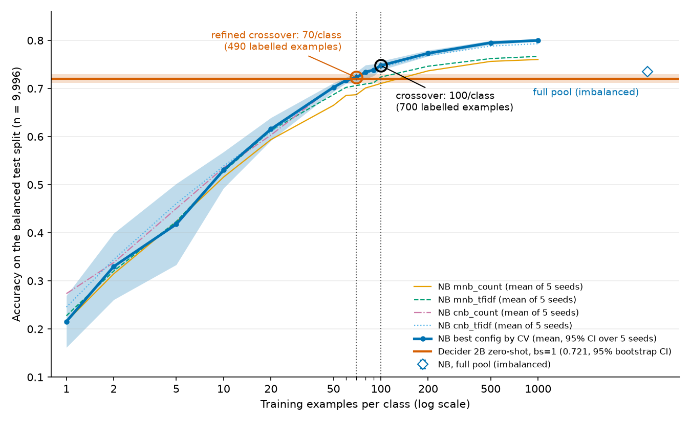
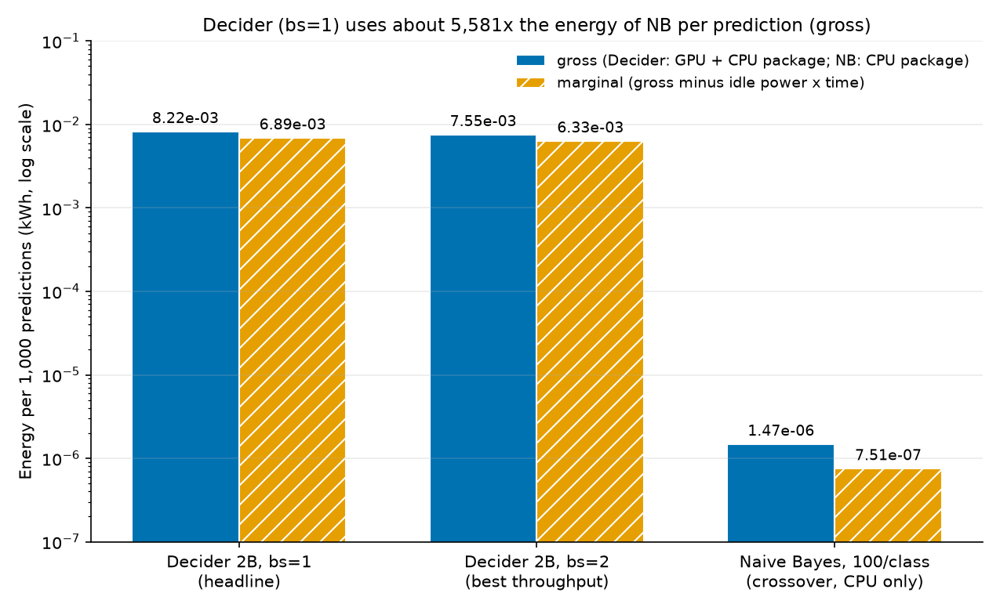

How many labelled examples does a tuned scikit-learn Naive Bayes need to match the zero-shot accuracy of AWS Strands Decider 2B, and what does each cost in energy? This is the full benchmark: WOS-46985, 7 classes, 9,996 test items, measured on one RTX 3090 with hardware energy counters.

The two approaches sit at opposite ends of the trade-off. Naive Bayes learns from labelled examples and runs on a single CPU thread. Decider is a 2B-parameter language model that needs no examples at all, only the names and descriptions of the labels, but runs on a GPU.

## 1. Summary

|  | Naive Bayes | Decider 2B | Edge |
| --- | --- | --- | --- |
| **What it is** | ComplementNB / MultinomialNB over word and word-pair counts (scikit-learn) | 2B-parameter language model (Qwen3.5-2B base), fine-tuned by AWS to pick between options | |
| **What it needs** | Labelled examples: 490 (70 per class) to tie | Label names and descriptions only (zero-shot) | Decider |
| **Runs on** | One CPU thread | GPU (RTX 3090) plus CPU | NB |
| **Accuracy at 70 per class** | 0.723 | 0.721 | Tie |
| **Accuracy at 100 per class** | 0.748 (better in 5/5 seeds) | 0.721 | NB |
| **Accuracy at 1,000 per class** | 0.800 | 0.721 | NB |
| **How you improve it** | Add labels: it keeps climbing to 0.80 | Reword the labels: dev 0.664 (blind) → 0.708 (taxonomy-informed) | NB |
| **Energy per 1,000 predictions** | 1.47 mWh | 8.22 Wh (≈5,600× gross, ≈9,200× marginal) | NB |
| **Latency per item (p50)** | 0.50 ms | 95.8 ms (≈194×) | NB |
| **Whole test set (9,996 items)** | 1.4 s | 17 min | NB |
| **One-off cost** | Tune and train: 7.3 s and 86 mWh at 100 per class, the energy of ≈10 Decider predictions | Load and warm up: 73 s and ≈4.1 Wh on every start | NB |
| **Calibration (ECE, lower is better)** | 0.21 (ComplementNB scores are not true probabilities) | 0.037 | Decider |
| **Same input, same answer?** | Always, byte for byte | Only with a fixed batch setup and option order: 0.3% flip if batching changes, 16.7% if the options are reordered | NB |
| **Main weakness** | Learns the class mix it was trained on: the imbalanced pool scores 0.735 | Prompt position bias (favours Medical Science when it is listed first) and confuses neighbouring fields | |

**In short:** Decider gets you to 72% on day one with no labels. Naive Bayes needs about 500 labels to match it, then beats it on accuracy, speed, energy and repeatability. Decider keeps the edge on calibration and on needing no labelled data.

Decider: strands-decider 0.1.0 · hobson-v21 @2b52a62. scikit-learn 1.9.1. Host: RTX 3090, Ryzen 9 3900. Accuracy at 70 and 100 per class is the mean of 5 seeds; the human cost of labelling is not counted.

### How each one makes a decision

- **Naive Bayes** turns the abstract into counts of words and word pairs, adds up how strongly each of those terms is associated with each class in the training data, and picks the highest-scoring class. Everything it knows comes from the labelled examples. The work per item is a sparse dot product, which takes well under a millisecond.
- **Decider** builds a prompt from the abstract plus all 7 option names and descriptions, runs the whole 2B-parameter model over it, and reads off a score for each option. Everything it knows comes from pre-training and AWS's fine-tuning, plus the label wording. The work per item is a full model pass over several hundred tokens, which takes about 100 ms on a GPU.

That difference explains most of what follows: NB's cost depends on the text in front of it, Decider's on the size of the model and the prompt.

**Code and data:** the full pipeline, plans, label wordings and every results file are in [jrgns/bayesian-vs-aws-decider](https://github.com/jrgns/bayesian-vs-aws-decider). File paths in this report (`results/…`, `scripts/…`, `docs/…`) are relative to that repo.

## 2. Dataset decision and contamination check

**Why the default candidates were rejected.** Decider's [model card](https://huggingface.co/StrandsAgents/strands-decider-2B-hobson-v21) (`datasets:` list) and [`data/sources.md`](https://github.com/strands-labs/strands-decider/blob/main/data/sources.md) (code commit `3e94e9d84c620ed5a95f1a3310c3decb971e261c`) show:

| Candidate              | In Decider's data                                                                                                                  | Verdict                 |
|------------------------|------------------------------------------------------------------------------------------------------------------------------------|-------------------------|
| `yahoo_answers_topics` | Yes: recipe `yahoo_topics`, role train                                                                                             | Rejected                |
| 20 Newsgroups          | `SetFit/20_newsgroups` is in the card's dataset list. It is not in the current recipe table, so an earlier recipe probably used it | Rejected (conservative) |
| DBpedia-14             | Yes: recipe `dbpedia`, train                                                                                                       | Rejected                |
| AG News                | Yes: recipe `ag_news`, train                                                                                                       | Rejected                |

(`docs/PLAN.md` section 0.) A name search for six aliases of Web of Science found no match in the card, `sources.md`, `recipes.py` or `training/recipe.sh` (`results/contamination_name_check.json`).

**Why WOS-46985 with level-1 labels.**

- It has 7 classes with plain-English names: Computer Science, Electrical Engineering, Psychology, Mechanical Engineering, Civil Engineering, Medical Science and Biochemistry.
- Abstracts run about 200 words: p50 is 262 text tokens and the maximum is 1,602, so nothing is truncated at Decider's 4,096-token window.
- It has 46,985 documents and is not on Decider's list under any name.

The HF script loader (`HDLTex/web_of_science`, rev `26ae29c3`) fails with the pinned `datasets` ("Dataset scripts are no longer supported"), so we use the original Mendeley archive that the script names. Archive sha256: `b787d484bff88b0dcdb3fa291d06ec9d2f025dc2a67ce1045d0c688cd96ccf8a`. Its `.txt` and `.xlsx` copies agree row by row, with 0 duplicates and 0 label conflicts (`results/dataset_summary.json`).

**13-gram scan.** We scanned all 46,985 items for exact matches and shared 13-grams (text lowercased, punctuation and whitespace normalised) against 78 Decider corpora, 7,878,760 rows in all. These were 43 files of the repo's `data/` tree at the pinned commit and 35 Hugging Face corpora rebuilt via `load_dataset` (`results/contamination.csv`, all 78 `status=ok`).

- **Exact full-text or prefix matches: 0.**
- **Items with any 13-gram hit: 254** of 46,985. In the provisional splits that was test 56 (0.56%), dev 13 and pool 185.
- **`ccdv/arxiv-classification` accounts for 236 of the 254 items** (931 hit rows). Decider trains on that dataset (recipe `arxiv_class`).
  - The most frequent shared n-grams are publisher boilerplate, for example "proceedings of the national academy of sciences of the united states of america" and the "open access article under the cc by nc nd license" clause (`results/contamination_top_ngrams.csv`).
  - A regex classification during the scan put about half of the 254 items as boilerplate-only. The other half shared topical abstract prose, mostly with arXiv: the same papers appear in both datasets. That split was not saved to a results file, so treat it as approximate.
  - Hits in other corpora, counted in items: HotpotQA 9, DBpedia-14 4, Yahoo Answers 4, PubMedQA 3, VitaminC 3, BoolQ 2, HelpSteer2 1. An item can hit several corpora, so these do not sum to 254.
- **All 254 items were removed before the final split.** This is stricter than the plan's 1% threshold (`results/dataset_summary.json`; `contamination_hits.csv` lists every hit).

**Residual limitation.** The pre-training corpus of the base model, Qwen3.5-2B-Base, is not published and cannot be checked. WOS abstracts may have been in it, which would favour Decider (section 7).

## 3. Setup

**Splits** (seed 20261005, `data/splits/*.csv`, `results/dataset_summary.json`). The 254 hit items were removed first.

| Split | Items  | Composition                                                   |
|-------|--------|---------------------------------------------------------------|
| test  | 9,996  | balanced, 1,428 per class                                     |
| dev   | 2,002  | balanced, 286 per class                                       |
| pool  | 34,733 | imbalanced, as in the source (Medical 37.0%, Mechanical 4.5%) |

The split sha256 hashes are in section 9. NB trains only on subsets of the pool. Decider's label wording was tuned only on dev. Both methods are scored on the same test items.

**NB protocol** (`scripts/nb_curve.py`).

- **Training sizes:** n ∈ {1, 2, 5, 10, 20, 50, 100, 200, 500, 1000} examples per class, with 5 seeds each (0–4). This is the pre-registered grid. After the main run, n ∈ {60, 70, 80, 90} were added to refine the crossover, with the same protocol, seeds and host; results from these are marked "refined". The pre-registered result is reported unchanged. Subsets are drawn from the pool with stratified, seeded sampling (saved in `results/nb/subsets/`). The whole pool ("full") is one extra point.
- **Variants:** {MultinomialNB, ComplementNB} × {CountVectorizer, TfidfVectorizer}, with ngram range (1, 2).
- **Grid:** `alpha` ∈ {0.001, 0.003, 0.01, 0.03, 0.1, 0.3, 1} × `min_df` ∈ {1, 2, 3}, which is 21 points per variant.
- **Selection:** stratified k-fold CV inside the subset, with k = min(5, n per class), scored by accuracy.
  - The best config is the highest CV mean over the 4 variants × 21 grid points. Ties go to the first variant in the order above.
  - n = 1 has no CV, so it uses the defaults (alpha 1, min_df 1) and MultinomialNB+Count is "best" by rule.
  - Every variant's test score is logged for reporting and never used for selection.
- **Manual CV ≡ `GridSearchCV`.** The CV loop is built from sklearn primitives so that vectorizer fits can be shared across alphas and across both NB classes.
  - `tests/test_nb_curve.py::test_manual_cv_matches_grid_search_exactly` checks bit-identical mean scores, best params and best score against `GridSearchCV` for all four variants, with the same `StratifiedKFold` and `error_score=nan`.
  - The same check passed on real data at n = 20 and n = 100 (step-5 commit message). That one-off script was not kept.
- **Execution:** single process, with BLAS and OpenMP pinned to one thread.

**Decider protocol** (`scripts/decider_run.py`).

- **Model:** `strands-decider` 0.1.0 with `StrandsAgents/strands-decider-2B-hobson-v21` and a pinned base-model revision (section 9).
- **Zero-shot:** no examples and no training. Each abstract is the `state` of a `choice` question with the 7 option names and descriptions.
- **Official batched evaluation path:** `strands_decider.evaluate.collect_logits(..., max_length=4096)`, then `predictions_from_logits` with the model's per-kind temperature (0.8177 for `choice`).
  - The default `max_length` is 3,072, which is not the model's window, so 4,096 is always passed.
  - The package renders the prompt itself, and options are never shuffled.
  - Per-slice calls give bit-identical logits to one big call at bs=1.
- **Checks:**
  - The model-card example reproduces within 0.0034 (tolerance 0.005; `results/decider_smoke.json`).
  - The `engine.ask` path agrees with the bs=1 path to within 5e-5 in probability.
- **Metrics** on per-item outputs: accuracy, macro-F1, 95% bootstrap CIs (10,000 resamples), Brier score and ECE (15 bins).

**Label wording** (`config/labels/`, `LOG.md`). Only rewording was allowed, never examples. Each version was scored on dev at bs=1.

| Version | Basis                                                                                   | Dev accuracy \[95% CI\]   | Dev macro-F1 |
|---------|-----------------------------------------------------------------------------------------|---------------------------|--------------|
| v1      | Blind: plain names plus general-knowledge one-liners, written before any Decider output | 0.6643 \[0.6434, 0.6848\] | 0.6667       |
| v2      | Plain prose written from the WOS category documentation (Domain → area names)           | 0.7013 \[0.6808, 0.7213\] | 0.7024       |
| v3      | v2 with only the Civil and Mechanical descriptions reworded (the "materials" overlap)   | 0.7078 \[0.6878, 0.7283\] | 0.7096       |

**Selection rule**, fixed before v2 was run:

- at most three versions;
- the highest dev accuracy wins;
- ties (to 4 d.p.) go to the earlier version.

**v3 was selected.** `scripts/select_labels.py` applies the rule in code (`results/selected_labels.json`).

- v2 and v3 are "taxonomy-informed" wording, which the project owner approved on 2026-10-06. Only v1 was written blind.
- The v2 → v3 gain (0.65 points) is inside the CI.

**Batch sizes.** The headline is the single run at bs=1.

- A throughput sweep on a fixed 700-item dev subset (100 per class, v3 wording) picked the smallest batch size within 3% of the fastest: **bs=2**, at 10.88 items/s against 10.10 at bs=1 (`results/decider_sweep.csv`, `decider_best_bs.json`).
- bs=128 ran out of GPU memory.
- The earlier sweep with v1 wording chose bs=4 (`decider_sweep_v1.csv`). A repeat of it (`*_pass2`) gave the same answer.
- **Batching changes outputs slightly.** On the test split, bs=1 and bs=2 disagree on 31 of 9,996 predictions (99.69% agree), with a maximum probability difference of 0.018.
- bs=2 is reported as a robustness row and as the best-throughput energy figure.

## 4. Results

### Learning curve (NB best config by CV, mean of 5 seeds)



| n/class                    | n_train | Accuracy (mean, 95% CI over seeds) | Macro-F1 | Brier | ECE   | Chosen variant (seeds)                        |
|----------------------------|---------|------------------------------------|----------|-------|-------|-----------------------------------------------|
| 1                          | 7       | 0.2156 \[0.1616, 0.2695\]          | 0.1669   | 1.459 | 0.707 | mnb_count ×5                                  |
| 2                          | 14      | 0.3299 \[0.2609, 0.3990\]          | 0.3224   | 0.939 | 0.280 | mnb_tfidf ×3, cnb_tfidf, cnb_count            |
| 5                          | 35      | 0.4178 \[0.3336, 0.5020\]          | 0.4124   | 0.892 | 0.301 | mnb_tfidf ×2, cnb_count, mnb_count, cnb_tfidf |
| 10                         | 70      | 0.5306 \[0.4929, 0.5682\]          | 0.5300   | 0.761 | 0.287 | cnb_tfidf ×2, mnb_tfidf, mnb_count, cnb_count |
| 20                         | 140     | 0.6155 \[0.5918, 0.6392\]          | 0.6126   | 0.665 | 0.291 | cnb_tfidf ×3, mnb_tfidf, cnb_count            |
| 50                         | 350     | 0.7024 \[0.6935, 0.7114\]          | 0.7013   | 0.574 | 0.284 | cnb_count ×2, cnb_tfidf ×2, mnb_tfidf         |
| 60 (refined)               | 420     | 0.7167 \[0.7106, 0.7228\]          | 0.7157   | 0.519 | 0.256 | cnb_count ×3, cnb_tfidf ×2                    |
| **70** (refined crossover) | 490     | **0.7228 \[0.7114, 0.7343\]**      | 0.7220   | 0.554 | 0.289 | cnb_count ×3, cnb_tfidf ×2                    |
| 80 (refined)               | 560     | 0.7342 \[0.7195, 0.7488\]          | 0.7330   | 0.477 | 0.225 | cnb_tfidf ×3, cnb_count ×2                    |
| 90 (refined)               | 630     | 0.7385 \[0.7263, 0.7506\]          | 0.7378   | 0.471 | 0.226 | cnb_tfidf ×3, cnb_count ×2                    |
| **100**                    | 700     | **0.7476 \[0.7384, 0.7568\]**      | 0.7460   | 0.460 | 0.211 | cnb_count ×4, cnb_tfidf                       |
| 200                        | 1,400   | 0.7732 \[0.7671, 0.7793\]          | 0.7726   | 0.427 | 0.207 | cnb_count ×5                                  |
| 500                        | 3,500   | 0.7951 \[0.7909, 0.7993\]          | 0.7946   | 0.391 | 0.191 | cnb_count ×5                                  |
| 1000                       | 7,000   | 0.8000 \[0.7976, 0.8024\]          | 0.7995   | 0.384 | 0.188 | cnb_count ×5                                  |
| full pool                  | 34,733  | 0.7347 \[0.7314, 0.7379\]          | 0.7284   | 0.466 | 0.187 | cnb_count ×3, cnb_tfidf ×2                    |

The 60–90 rows were added after the main run (same protocol, 5 seeds; `results/nb_meta_n60-70-80-90.json`). Source: `results/nb_runs.csv` (rows with `is_best`) and `nb_best_configs.json`. The "full pool" row is not part of the n-per-class series (see below). Its training set is the same for every seed, so its seeds only change the CV fold shuffle.

### Decider (zero-shot, test split, 9,996 items)

| Run                             | Accuracy \[95% CI\]       | Macro-F1 \[95% CI\]       | Brier | ECE   | Items/s |
|---------------------------------|---------------------------|---------------------------|-------|-------|---------|
| `test_v3_bs1` (headline)        | 0.7207 \[0.7119, 0.7294\] | 0.7220 \[0.7132, 0.7305\] | 0.392 | 0.037 | 9.82    |
| `test_v3_bs2` (best throughput) | 0.7197 \[0.7109, 0.7283\] | 0.7210 \[0.7122, 0.7295\] | 0.391 | 0.037 | 10.58   |

Source: `results/decider_runs.csv`.

Per-class recall at bs=1 (`results/decider/test_v3_bs1.json`): Computer Science 0.83, Electrical 0.64, Psychology 0.72, Mechanical 0.75, Civil 0.60, Medical 0.77, Biochemistry 0.74. The largest confusions are Biochemistry → Medical (332 items), Civil → Mechanical (279), Electrical → Mechanical (247) and Psychology → Medical (247).

### Head to head

Decider against NB at the three training sizes that matter: the tie, the pre-registered crossover, and the largest planned size. NB figures are means over 5 seeds.

|                        | Labelled examples | Accuracy   | Macro-F1   | Brier     | ECE       |
|------------------------|-------------------|------------|------------|-----------|-----------|
| Decider, zero-shot     | 0                 | 0.7207     | 0.7220     | 0.392     | **0.037** |
| NB, 70 per class       | 490               | 0.7228     | 0.7220     | 0.554     | 0.289     |
| NB, 100 per class      | 700               | 0.7476     | 0.7460     | 0.460     | 0.211     |
| NB, 1,000 per class    | 7,000             | **0.8000** | **0.7995** | **0.384** | 0.188     |

- **Accuracy:** at 70 per class the two are level. From there, every extra label moves NB further ahead; Decider has no equivalent lever.
- **Confidence:** Decider's probabilities mean what they say (ECE 0.037). NB's are poorly calibrated, partly because ComplementNB's scores aren't true probabilities (see Calibration below). If you route low-confidence items to a human, Decider's scores are the ones to trust.
- **They are right about different items.** Even at the tie, each method gets roughly 1,000–1,250 test items right that the other gets wrong (the b/c columns below). Their errors overlap less than their matching accuracy suggests.

### Crossover (exact McNemar, NB best config vs `test_v3_bs1`, identical 9,996 item ids)

**Rule** (PLAN §6): the smallest n where (a) NB's mean accuracy is at least Decider's, and (b) for a majority of the 5 seeds, McNemar is either not significant at α = 0.05 or shows NB significantly better. The full pool is excluded from the search.

**Result on the pre-registered grid: n = 100 per class (700 labelled examples).** In the table, b/c means items only NB got right / items only Decider got right, per seed. At n = 100 every McNemar p-value is below 1e-5 in NB's favour, so all 5 seeds qualify.

**Refinement (added after the main run, same protocol and seeds): n = 70 per class (490 labelled examples).** Applying the same rule to the grid plus 60, 70, 80 and 90 gives 70. It is a marginal tie, not a clear win:

- NB's mean, 0.7228, is 0.2 points above Decider's, and the gap CI \[−0.0099, +0.0053\] includes zero.
- Per seed, the McNemar p-values at 70 are 0.82, 0.022 (NB better), 0.040 (Decider better), 0.017 (NB better) and 0.48. So one seed (seed 2) is significantly worse.
- At 60, NB's mean (0.7167) is still below Decider's, so the rule fails there even though 4 of 5 seeds qualify.
- From 80 per class onward every seed favours NB and the gap CI excludes zero.

| n/class                  | NB mean | Decider | Gap, Decider − NB \[95% CI\]     | Seeds qualifying | Seed 0 b/c | Seed 1    | Seed 2    | Seed 3    | Seed 4    |
|--------------------------|---------|---------|----------------------------------|------------------|------------|-----------|-----------|-----------|-----------|
| 20                       | 0.6155  | 0.7207  | +0.1052 \[+0.0973, +0.1132\]     | 0/5              | 1031/2271  | 999/1805  | 1033/2039 | 906/2155  | 1058/2014 |
| 50                       | 0.7024  | 0.7207  | +0.0183 \[+0.0106, +0.0257\]     | 0/5              | 1111/1407  | 1019/1228 | 1013/1132 | 1154/1287 | 1130/1286 |
| 60 (refined)             | 0.7167  | 0.7207  | +0.0040 \[−0.0037, +0.0116\]     | 4/5              | 1186/1204  | 1194/1304 | 1153/1133 | 1226/1256 | 1104/1166 |
| **70** (refined)         | 0.7228  | 0.7207  | **−0.0022 \[−0.0099, +0.0053\]** | **4/5**          | 1140/1128  | 1185/1075 | 1021/1117 | 1241/1124 | 1136/1171 |
| 80 (refined)             | 0.7342  | 0.7207  | −0.0135 \[−0.0212, −0.0059\]     | 5/5              | 1224/1165  | 1291/1036 | 1103/1049 | 1327/1056 | 1087/1053 |
| 90 (refined)             | 0.7385  | 0.7207  | −0.0178 \[−0.0254, −0.0103\]     | 5/5              | 1152/1058  | 1261/1055 | 1180/995  | 1177/1097 | 1306/983  |
| **100** (pre-registered) | 0.7476  | 0.7207  | **−0.0269 \[−0.0345, −0.0192\]** | **5/5**          | 1150/942   | 1304/1038 | 1338/943  | 1283/1060 | 1199/947  |
| 200                      | 0.7732  | 0.7207  | −0.0525 \[−0.0601, −0.0450\]     | 5/5              | 1322/819   | 1326/781  | 1321/806  | 1378/781  | 1284/819  |
| 1000                     | 0.8000  | 0.7207  | −0.0793 \[−0.0871, −0.0716\]     | 5/5              | 1392/577   | 1379/587  | 1362/579  | 1360/553  | 1356/590  |

n = 1 to 10 are further behind, with gaps from +0.50 to +0.19 and 0/5 seeds qualifying. Every n, seed and Decider run is in `results/crossover.csv`, and the summary is in `results/crossover.json`.

The gap CI is a paired bootstrap over test items: Decider's per-item correctness minus NB's per-item correctness averaged over seeds. It captures test-set sampling noise, not variation between training subsets; that is the seed CI in the learning-curve table.

- **Largest planned n below the pre-registered crossover (50 per class):** NB trails by 1.83 points \[1.06, 2.57\]. The McNemar p-values per seed are 4.0e-9, 1.1e-5, 0.011, 0.0075 and 0.0016, and all five favour Decider.
- **The tie lies near 70 per class.** The pre-registered grid had no point between 50 and 100, so it reported 100. The refinement puts the crossover at 70.
- **Robustness (`test_v3_bs2`):** the crossovers are the same. On the pre-registered grid it is 100 per class, with 5/5 seeds and a gap of −0.0279 \[−0.0355, −0.0203\]. With the refinement it is 70 per class, with 5/5 seeds and a gap of −0.0032. At 50 per class all five p-values are below 0.021, with a gap of +0.0173 \[+0.0096, +0.0247\].
- **Full pool (34,733 items, about 4,962 per class, imbalanced), reported separately:**
  - NB scores 0.7347 \[0.7314, 0.7379\] and beats Decider in all 5 seeds (b/c from 1205/1059 to 1231/1065; p from 0.0006 to 0.048, with seed 4 borderline).
  - It is **5.5 points worse than NB trained on 1,000 per class** (0.8000). The cause is prior shift: the pool is 37.0% Medical and 4.5% Mechanical, while the test split is 14.3% per class.
  - Seed 0 predicts Medical for 21.3% of test items (the n = 1000 model: 13.2%) and Mechanical for 6.5% (13.8%).
  - Medical recall rises to 0.883 (n = 1000: 0.702) and Mechanical recall falls to 0.423 (n = 1000: 0.799).
  - Details are in `crossover.json` under `full_pool`.

### Calibration

Decider is much better calibrated than NB:

|                                   | Brier | ECE   |
|-----------------------------------|-------|-------|
| Decider, bs=1                     | 0.392 | 0.037 |
| NB, at the crossover (100)        | 0.460 | 0.211 |
| NB, at the refined crossover (70) | 0.554 | 0.289 |
| NB, 1,000 per class               | 0.384 | 0.188 |

**ComplementNB's `predict_proba` is a softmax of complement-weighted scores, not a calibrated probability** (`results/nb_meta.json`), so its Brier and ECE can't be compared directly with MultinomialNB's. From 100 per class upward the best config is mostly ComplementNB, so the NB figures above mix both. Mean Brier / ECE per variant over seeds:

| n/class | mnb_count     | mnb_tfidf     | cnb_count     | cnb_tfidf     |
|---------|---------------|---------------|---------------|---------------|
| 10      | 0.937 / 0.462 | 0.675 / 0.195 | 0.832 / 0.387 | 0.673 / 0.196 |
| 100     | 0.562 / 0.278 | 0.456 / 0.181 | 0.469 / 0.224 | 0.466 / 0.241 |
| 1000    | 0.471 / 0.233 | 0.351 / 0.077 | 0.384 / 0.188 | 0.328 / 0.086 |
| full    | 0.506 / 0.252 | 0.431 / 0.193 | 0.513 / 0.253 | 0.394 / 0.086 |

### NB variants (test accuracy, mean of 5 seeds; never used for selection)

| n/class | mnb_count | mnb_tfidf | cnb_count | cnb_tfidf | Best by CV |
|---------|-----------|-----------|-----------|-----------|------------|
| 1       | 0.2156    | 0.2276    | 0.2735    | 0.2456    | 0.2156     |
| 2       | 0.3147    | 0.3204    | 0.3381    | 0.3445    | 0.3299     |
| 5       | 0.4225    | 0.4234    | 0.4504    | 0.4606    | 0.4178     |
| 10      | 0.5159    | 0.5274    | 0.5351    | 0.5388    | 0.5306     |
| 20      | 0.5937    | 0.6126    | 0.6031    | 0.6097    | 0.6155     |
| 50      | 0.6649    | 0.6874    | 0.7041    | 0.7034    | 0.7024     |
| 60      | 0.6854    | 0.7022    | 0.7145    | 0.7177    | 0.7167     |
| 70      | 0.6872    | 0.7061    | 0.7238    | 0.7218    | 0.7228     |
| 80      | 0.7011    | 0.7093    | 0.7363    | 0.7309    | 0.7342     |
| 90      | 0.7059    | 0.7117    | 0.7395    | 0.7353    | 0.7385     |
| 100     | 0.7104    | 0.7237    | 0.7485    | 0.7438    | 0.7476     |
| 200     | 0.7367    | 0.7462    | 0.7732    | 0.7685    | 0.7732     |
| 500     | 0.7563    | 0.7622    | 0.7951    | 0.7881    | 0.7951     |
| 1000    | 0.7602    | 0.7667    | 0.8000    | 0.7931    | 0.8000     |
| full    | 0.7448    | 0.7448    | 0.7342    | 0.7361    | 0.7347     |

- ComplementNB leads from 50 per class upward. MultinomialNB leads on the imbalanced pool (0.7448 vs 0.7342).
- Below 20 per class, CV selection is noisy:
  - at n = 1 the rule fixes MultinomialNB+Count (0.2156), while ComplementNB+Count scores 0.2735;
  - at n = 5 the CV-selected config (0.4178) scores below every single variant.
- Neither affects the crossover. That is decided at 50–100 per class, where the CV choice is within 0.2 points of the best variant.

Source: `results/nb_runs.csv`.

## 5. Energy



**Method.** Hardware counters only: NVML total energy for the GPU and RAPL `package-0` for the CPU. Each is read over a window, and a 60 s idle baseline is measured the same way. Gross is the counter delta. Marginal is gross minus idle power × duration. kWh = J / 3.6e6.

- **Decider** energy is GPU plus CPU package over the inference phase. Model load and warmup are reported separately and excluded.
- **NB** energy is the CPU package only, because NB needs no GPU. The GPU's idle draw (about 25 W) was recorded during NB runs but is not attributed to NB.
- NB phases are too short for a clean counter window. Each one is repeated until the window lasts at least 10 s, and the energy is divided by the number of repeats (`*_reps` columns in `nb_runs.csv`).
- **NB "tune+fit"** is the CV tuning phase plus the final refit phase. The tuning phase already refits each variant's best config, so tune+fit counts about one refit twice (about 2% at n ≥ 100).
- **NB "fit-only"** is the refit of the chosen config alone: the cost when the config is already known.

### Inference, kWh per 1,000 predictions

| Method                         | Gross                                 | Marginal                             | Note                                   |
|--------------------------------|---------------------------------------|--------------------------------------|----------------------------------------|
| Decider bs=1 (headline)        | 8.219e-3 (GPU 7.059e-3, CPU 1.160e-3) | 6.889e-3 (GPU 6.299e-3, CPU 5.90e-4) | 29.6 J / 24.8 J per prediction         |
| Decider bs=2 (best throughput) | 7.553e-3 (GPU 6.493e-3, CPU 1.060e-3) | 6.331e-3 (GPU 5.796e-3, CPU 5.35e-4) |                                        |
| NB at the crossover, 100/class | 1.473e-6 \[1.386e-6, 1.560e-6\]       | 7.51e-7 \[6.58e-7, 8.44e-7\]         | CI over 5 seeds; 5.3 mJ per prediction |
| NB, 1000/class                 | 1.627e-6 \[1.549e-6, 1.706e-6\]       | 8.09e-7 \[7.21e-7, 8.97e-7\]         |                                        |
| NB, full pool                  | 2.056e-6 \[1.914e-6, 2.198e-6\]       | 1.043e-6 \[9.27e-7, 1.159e-6\]       | larger vocabulary                      |

Decider bs=1 uses 5,581× (gross) and 9,174× (marginal) the energy of NB at 100 per class. Source: `results/energy_summary.csv` (table `inference`).

**In plain terms (gross, bs=1 vs NB at 100 per class):**

|                                  | Naive Bayes                     | Decider 2B                       |
|----------------------------------|---------------------------------|----------------------------------|
| Energy per prediction            | 5.3 mJ                          | 29.6 J                           |
| Energy per million predictions   | ≈1.5 Wh                         | ≈8.2 kWh                         |
| Hardware drawing power           | One CPU core                    | GPU board (86% of the energy) plus CPU package |
| One-off cost before predicting   | Tune and train: 86 mWh          | Load and warm up: ≈4.1 Wh, on every start |

Decider's start-up alone uses about 47× the energy of tuning and training NB from scratch.

### Decider load and warmup (separate, excluded from the above)

| Run  | Load (time; gross; marginal)     | Warmup (time; gross; marginal)   |
|------|----------------------------------|----------------------------------|
| bs=1 | 15.0 s; 3.18e-4 kWh; 1.22e-4 kWh | 58.2 s; 3.74e-3 kWh; 2.98e-3 kWh |
| bs=2 | 14.9 s; 3.17e-4 kWh; 1.25e-4 kWh | 58.4 s; 3.78e-3 kWh; 3.03e-3 kWh |

Decider's own training energy is AWS's sunk cost and is out of scope.

### NB training energy at every curve point (kWh, mean and 95% CI over 5 seeds)

| n/class          | Tune+fit, gross                  | Tune+fit, marginal           | Fit-only, gross              | Fit-only, marginal           | Tune wall-clock (s) |
|------------------|----------------------------------|------------------------------|------------------------------|------------------------------|---------------------|
| 1                | 1.86e-07 (1.76e-07–1.96e-07)     | 9.52e-08 (8.68e-08–1.04e-07) | 3.84e-08 (3.79e-08–3.90e-08) | 2.09e-08 (1.94e-08–2.24e-08) | 0.01                |
| 2                | 3.20e-06 (2.93e-06–3.47e-06)     | 1.72e-06 (1.45e-06–1.99e-06) | 5.94e-08 (4.93e-08–6.96e-08) | 3.08e-08 (2.64e-08–3.51e-08) | 0.28                |
| 5                | 1.01e-05 (8.95e-06–1.12e-05)     | 5.44e-06 (4.28e-06–6.60e-06) | 1.16e-07 (8.03e-08–1.51e-07) | 6.11e-08 (4.25e-08–7.97e-08) | 0.88                |
| 10               | 1.37e-05 (1.28e-05–1.45e-05)     | 7.30e-06 (6.43e-06–8.16e-06) | 2.42e-07 (1.76e-07–3.07e-07) | 1.28e-07 (8.26e-08–1.74e-07) | 1.19                |
| 20               | 2.05e-05 (1.91e-05–2.19e-05)     | 1.06e-05 (9.39e-06–1.19e-05) | 4.47e-07 (3.39e-07–5.55e-07) | 2.24e-07 (1.67e-07–2.81e-07) | 1.84                |
| 50               | 4.31e-05 (4.09e-05–4.53e-05)     | 2.26e-05 (2.04e-05–2.49e-05) | 1.04e-06 (7.75e-07–1.31e-06) | 5.22e-07 (3.77e-07–6.68e-07) | 3.79                |
| 60               | 5.35e-05 (4.90e-05–5.81e-05)     | 2.80e-05 (2.59e-05–3.01e-05) | 1.20e-06 (8.50e-07–1.54e-06) | 6.10e-07 (4.48e-07–7.72e-07) | 4.71                |
| **70** (refined) | **5.73e-05 (5.43e-05–6.02e-05)** | 2.89e-05 (2.59e-05–3.18e-05) | 1.31e-06 (9.43e-07–1.67e-06) | 6.69e-07 (4.72e-07–8.65e-07) | 5.23                |
| 80               | 6.70e-05 (6.36e-05–7.04e-05)     | 3.47e-05 (3.14e-05–3.81e-05) | 1.58e-06 (1.08e-06–2.08e-06) | 7.89e-07 (5.58e-07–1.02e-06) | 5.93                |
| 90               | 7.44e-05 (7.18e-05–7.71e-05)     | 3.78e-05 (3.52e-05–4.04e-05) | 1.69e-06 (1.13e-06–2.26e-06) | 8.57e-07 (5.26e-07–1.19e-06) | 6.74                |
| **100**          | **8.59e-05 (8.27e-05–8.90e-05)** | 4.68e-05 (4.46e-05–4.91e-05) | 1.72e-06 (1.57e-06–1.87e-06) | 8.90e-07 (7.40e-07–1.04e-06) | 7.28                |
| 200              | 1.70e-04 (1.58e-04–1.81e-04)     | 8.84e-05 (7.84e-05–9.84e-05) | 3.39e-06 (3.21e-06–3.57e-06) | 1.72e-06 (1.54e-06–1.90e-06) | 15.16               |
| 500              | 4.37e-04 (3.87e-04–4.87e-04)     | 2.29e-04 (1.80e-04–2.77e-04) | 8.32e-06 (7.99e-06–8.64e-06) | 4.10e-06 (3.81e-06–4.39e-06) | 38.83               |
| 1000             | 8.55e-04 (8.23e-04–8.88e-04)     | 4.41e-04 (4.10e-04–4.73e-04) | 1.73e-05 (1.65e-05–1.81e-05) | 8.68e-06 (7.92e-06–9.44e-06) | 77.16               |
| full             | 4.50e-03 (4.37e-03–4.63e-03)     | 2.25e-03 (2.17e-03–2.34e-03) | 1.03e-04 (8.21e-05–1.24e-04) | 4.98e-05 (3.89e-05–6.06e-05) | 417.73              |

- Tuning dominates: it is about 98% of training energy at every n ≥ 2, because the grid is 4 variants × 21 points × up to 5 folds.
- Training energy grows roughly linearly with n: 86 mWh at 100 per class, 0.86 Wh at 1,000 per class.

Source: `results/energy_summary.csv` (table `nb_training`).

### Break-even

N\* = NB training energy / (Decider energy per prediction − NB energy per prediction). It is the number of predictions after which NB's total energy (training plus inference) is lower than Decider's. Figures are against Decider bs=1, and the CI propagates the CI of the training energy. Source: table `break_even`.

| NB trained at         | Training counted | Gross N\*           | Marginal N\*        |
|-----------------------|------------------|---------------------|---------------------|
| 100/class (crossover) | tune+fit         | 10.5 \[10.1, 10.8\] | 6.8 \[6.5, 7.1\]    |
| 100/class (crossover) | fit-only         | 0.21 \[0.19, 0.23\] | 0.13 \[0.11, 0.15\] |
| 1000/class            | tune+fit         | 104 \[100, 108\]    | 64 \[59, 69\]       |
| 1000/class            | fit-only         | 2.1 \[2.0, 2.2\]    | 1.3 \[1.1, 1.4\]    |

Against Decider bs=2, N\* is 11.4, 7.4, 0.23 and 0.14 at 100 per class, and 113, 70, 2.3 and 1.4 at 1000 per class.

**At the refined crossover (70 per class):**

- **Training:** 57.3 mWh gross \[54.3, 60.2\] (28.9 mWh marginal) with tuning, or 1.31 mWh gross (0.67 mWh marginal) for the refit alone.
- **Inference:** 1.537e-6 kWh per 1,000 predictions gross \[1.455e-6, 1.619e-6\] (8.00e-7 marginal). Decider bs=1 uses about 5,350× (gross) and 8,610× (marginal) that.
- **Break-even against Decider bs=1:** N\* = 7.0 \[6.6, 7.3\] gross and 4.2 \[3.8, 4.6\] marginal with tuning, and 0.16 and 0.097 for the refit alone. Against bs=2: 7.6, 4.6, 0.17 and 0.11.

Source: `results/energy_summary.csv`, subjects `nb_n70` and `decider_bs1_vs_nb_n70`.

Even with tuning included, NB's whole training cost is repaid within a few tens of predictions. The refit alone costs less than one Decider prediction.

### Latency and wall-clock

|                                    | Decider bs=1    | Decider bs=2                        | NB at 100/class                  |
|------------------------------------|-----------------|-------------------------------------|----------------------------------|
| Test set (9,996 items), wall-clock | 1,018 s         | 945 s                               | 1.36 s \[1.27, 1.44\] (1 thread) |
| Per-item p50 / p95 (one at a time) | 95.8 / 121.8 ms | 90.6 / 111.2 ms (batch latency / 2) | **0.495 / 0.599 ms**             |
| Per-item, batched                  |                 |                                     | 0.136 ms (whole test set / n)    |
| Throughput, items/s                | 9.82            | 10.58                               | ≈7,350 (1 thread, batched)       |
| Training wall-clock (tune; refit)  |                 |                                     | 7.3 s; 0.16 s                    |
| Start-up (load; warmup)            | 15.0 s; 58.2 s  | 14.9 s; 58.4 s                      |                                  |

NB's single-item latency was measured on orion (`scripts/nb_latency.py`, `results/nb_latency.json`):

- The seed-0 best config (ComplementNB+Count, alpha 0.3, min_df 2) was retrained from its saved subset. It reproduced the saved test predictions on 100% of items.
- The first 1,000 test items were then scored one at a time: vectorise plus `predict_proba`, timed with `perf_counter`, on 1 thread, after 20 warmup calls.
- Decider's single-item p50 latency is about 194× NB's.

Sources: `decider_runs.csv`, `nb_runs.csv`, `energy_summary.csv` (table `timing`).

## 6. Stability (flip rate)

Are the predictions repeatable? 1,000 test items were re-run 5–10 times under each condition, every run in a separate process. Half the items are near Decider's decision boundary; the reweighted figure (10% near-boundary, 90% rest) estimates the flip rate on the full test set. Details are in the appendix below.

| Method / setup                             | Test accuracy | kWh per 1,000 predictions (gross) | Flip rate, reweighted | Bit-for-bit repeatable                                            |
|--------------------------------------------|---------------|-----------------------------------|-----------------------|-------------------------------------------------------------------|
| NB, 100/class (crossover config)           | 0.7476        | 1.47e-6                           | **0%**                | yes (10 runs in one process, plus 10 separate retrains)           |
| Decider bs=1, fixed setup                  | 0.7207        | 8.22e-3                           | **0%**                | yes (10 processes, default PyTorch)                               |
| Decider bs=2, fixed setup                  | 0.7197        | 7.55e-3                           | **0%**                | yes (10 processes, default PyTorch; also with deterministic mode) |
| Decider, bs=1 vs bs=2                      |               |                                   | 0.30%                 | no                                                                |
| Decider, different batch neighbours (bs=2) |               |                                   | 0.24%                 | no                                                                |
| Decider, option order shuffled             |               |                                   | 16.7%                 | no                                                                |

- **NB never flips.** Its outputs are byte-identical across processes.
- **Decider is bit-for-bit repeatable when the setup is fixed:** the same batch size, batch composition and option order. PyTorch deterministic mode adds nothing on this stack and costs about 7% throughput.
- **Changing the batch size or the batch neighbours flips about 1 prediction in 300.** All of these are near-ties, so the effect is float rounding.
- **Shuffling the option order flips about 1 prediction in 6.** That is a genuine prompt-order effect: the model favours Medical Science when it is listed first.
- **In production, keep the batch setup fixed and never reorder the options.**

**What can change the answer for the same input:**

|                                   | Naive Bayes | Decider 2B                      |
|-----------------------------------|-------------|---------------------------------|
| Re-running, new process           | No          | No                              |
| Retraining on the same data       | No          | n/a                             |
| Batch size                        | n/a         | Yes, for ≈0.3% of items         |
| Which items share a batch         | n/a         | Yes, for ≈0.24% of items        |
| Order of the options in the prompt | n/a        | Yes, for ≈16.7% of items        |
| Wording of the labels             | n/a         | Yes (dev accuracy 0.664 to 0.708 across three wordings) |
| The training data                 | Yes         | n/a (fixed by AWS)              |

NB's output is a function of its training data and nothing else. Decider's also depends on how it is served and how the prompt is written, which are easy to change by accident.

## 7. Threats to validity

- **Unknown base-model pre-training data.** Qwen3.5-2B-Base's pre-training corpus is not published. WOS abstracts could be in it, which would inflate Decider's accuracy. Overlap with Decider's fine-tuning data was checked (section 2), and the overlapping items were removed.

- **Label wording informed by the taxonomy, and best-of-3 selection on dev.** v2 and v3 were written from the WOS category documentation, and the winner was picked on dev from 3 versions.

  - That gives Decider a small optimistic bias.
  - Test accuracy (0.7207) is above the dev score (0.7078), so there is no sign of overfitting to dev.
  - This is also the setup that favours Decider. A user without the taxonomy would write something closer to v1 (dev 0.664).
  - NB gets no wording help, but it does get labelled data.

- **WOS taxonomy ambiguity.** Depression and Schizophrenia appear under both Psychology and Medical, and other pairs are close (Biochemistry vs Medical, Civil vs Mechanical). Both methods face a ceiling below 100%, and Decider's errors concentrate on exactly these pairs.

- **The refinement was added after the results were seen.** Sizes 60–90 were added after the planned grid showed the tie lies between 50 and 100. They use the same protocol and seeds and select nothing by test score, but the refined crossover (70) is post hoc. The pre-registered answer is 100 per class. At 70 the result is a tie whose CI includes zero.

- **Full-pool imbalance.** The full pool is not part of the crossover search. It scores below 1,000 per class because of prior shift (section 4).

- **ComplementNB calibration.** CNB's probabilities are not calibrated, so NB's Brier and ECE are not a fair comparison with Decider's. Accuracy and McNemar don't depend on calibration.

- **The NB tuning grid drives NB's training energy.** The grid (4 variants × 21 points × up to 5 folds) is a choice. A smaller grid would cut training energy roughly in proportion. The fit-only figures give a lower bound, and the break-even conclusion holds either way.

- **RAPL is package-level only.** orion's Zen 2 CPU exposes no DRAM domain, so memory energy is not counted for either method.

- **NVML covers the GPU board only.** PSU conversion losses and other host components are not included.

- **No wall-power cross-check.** orion has no wall meter or exporter, so `wall` is "not configured" in every record and the counters could not be validated against the wall. There is a sanity check against `nvidia-smi` and a busy-CPU test in `results/energy_sanity.json`.

- **Host noise.** 4 other containers (portainer agent, traefik, cadvisor, dcgm-exporter) and some host processes kept running during every headline measurement. The load indicators are recorded per window in `results/energy.csv`:

  - host CPU utilisation was about 0.4–0.8% in idle windows, about 4.5–5.3% in Decider inference windows, and 4.6% on average (max 6.7%) in NB windows;
  - the 1-minute load average was 0.4–1.5.

  The NB curve ran for about 79 minutes on a single idle baseline taken at its start.

- **The idle baseline was taken before the CUDA context existed.** GPU idle draw with a context may be a few watts higher (mean power during model load was 31.5 W vs 26.8 W idle), so Decider's marginal GPU energy is slightly overstated.

- **Docker overhead cancels in the marginal figures.** Every measurement runs in the same container setup, so daemon and container overhead appears in both the idle and the active windows. It is not removed from the gross figures.

- **One hardware setup.** One RTX 3090 and one CPU (Ryzen 9 3900). A newer GPU or a different batching strategy would change Decider's energy.

- **The cost of human labelling is not counted.** NB at the crossover needs 700 labelled abstracts; Decider needs none, only the label wording.

- **Batch size changes outputs.** bs=1 and bs=2 differ on 31 predictions, and logits are not bitwise identical across batch sizes (bf16 padding). This is why the headline uses bs=1. Section 6 measures it fully.

- **Some energy was measured while 22 containers were running.** That covers `dev_v1_bs1` and the meter sanity run, and neither is used in the headline. The test runs, the v3 sweep and the NB measurements ran with 4 containers.

## 8. Reproduce

**Prerequisites:**

- a Linux host with Docker (compose v2);
- an NVIDIA GPU with the NVIDIA container toolkit (reference: 2× RTX 3090, driver 595.91.07; the pipeline uses GPU 0);
- readable RAPL counters under `/sys/devices/virtual/powercap`, bind-mounted read-only with no extra privileges;
- network access to Hugging Face, GitHub and Mendeley;
- an idle GPU. `preflight_host.sh` aborts if a GPU is busy, and it never stops anything.

Clone [the repo](https://github.com/jrgns/bayesian-vs-aws-decider) and run from its root:

```bash
ALLOW_TEST=1 ./run_all.sh            # everything, end to end
DRY_RUN=1 ALLOW_TEST=1 ./run_all.sh  # print each stage as skip / RUN; touches nothing
```

**Stages, in order:** dataset, contamination, split, versions, smoke test, dev runs for v1/v2/v3, `select_labels`, the sweep with the selected wording, test runs at bs=1 and at the best batch size, NB curve, crossover, NB latency, energy summary and plots.

- A stage is skipped when its output exists. Delete the file to rerun it.
- `ALLOW_TEST=1` is required for every stage that touches test results, and no script sets it.
- **Recorded run times:** about 79 minutes for the NB curve (`nb_meta.json`), plus 14 minutes for the 60–90 refinement (`nb_meta_n60-70-80-90.json`). Each Decider test run took 16–17 minutes of inference, plus 60 s idle baseline, 15 s load and 58 s warmup.
- Lint and tests: `docker compose run --rm dev`.
- The analysis stages (`crossover`, `energy_summary`, `plots`) are CPU only and need nothing but `results/`.

## 9. Versions

From `results/versions.json` unless noted.

| Item                                                                             | Value                                                                                                                                                                                               |
|----------------------------------------------------------------------------------|-----------------------------------------------------------------------------------------------------------------------------------------------------------------------------------------------------|
| Python                                                                           | 3.12.15                                                                                                                                                                                             |
| torch                                                                            | 2.14.1+cu130 (CUDA 13.0)                                                                                                                                                                            |
| cuDNN                                                                            | 9.24.0 (reported as 92400)                                                                                                                                                                          |
| NVIDIA driver                                                                    | 595.91.07                                                                                                                                                                                           |
| GPU                                                                              | NVIDIA GeForce RTX 3090 (`GPU-1e7c68c6-0837-0871-bcdd-7e41798fc63b`)                                                                                                                                |
| CPU                                                                              | AMD Ryzen 9 3900 12-Core Processor                                                                                                                                                                  |
| Kernel                                                                           | 7.0.0-34-generic (x86_64)                                                                                                                                                                           |
| scikit-learn / numpy / scipy                                                     | 1.9.1 / 2.5.3 / 1.18.1                                                                                                                                                                              |
| transformers / peft                                                              | 5.18.0 / 0.21.2                                                                                                                                                                                     |
| strands-decider (PyPI)                                                           | 0.1.0                                                                                                                                                                                               |
| Decider model                                                                    | `StrandsAgents/strands-decider-2B-hobson-v21`, revision `2b52a6235c1b8306bbfa30b00b9d4b74b63a39f5`                                                                                                  |
| Base model                                                                       | `Qwen/Qwen3.5-2B-Base`, revision `b1485b2fa6dfa1287294f269f5fb618e03d52d7c`                                                                                                                         |
| causal-conv1d                                                                    | 1.7.0 (built into the image; seen by transformers)                                                                                                                                                  |
| Decider GitHub commit (training-data inventory; `contamination_name_check.json`) | `3e94e9d84c620ed5a95f1a3310c3decb971e261c`                                                                                                                                                          |
| Image id at the smoke run                                                        | `sha256:b783694e1ecc954c607dd7d8c9c90850fc870a37bf5e739ea665a855c3b2eab4`. The image was later rebuilt (id `e30be7c184df`) to add scripts; `uv.lock` and the Dockerfile are unchanged since step 1b |
| Dataset archive sha256                                                           | `b787d484bff88b0dcdb3fa291d06ec9d2f025dc2a67ce1045d0c688cd96ccf8a`                                                                                                                                  |
| Split sha256, test                                                               | `1b777e657fe53ba5d2b81223681fd3b9bf724653d14b7aa61810b3fe506c2729`                                                                                                                                  |
| Split sha256, dev                                                                | `9a6dc979d4ee3777bee1306e7bd3c403e84b812e682dd971ae7c5ef352f1eee9`                                                                                                                                  |
| Split sha256, pool                                                               | `00f56b319b8df45a95d900282fd4da9a957eaff70964d2078fb42aabb85a46f2`                                                                                                                                  |

## Appendix: stability test (STABILITY.md)

This is part of the main report; the plan is in `docs/PLAN_STABILITY.md`. Nothing was tuned to reduce flips. Everything is the same as the main run: image, lockfile, dataset, test split, Decider release and label wording v3. Every Decider run went through the official `collect_logits` path, as its own `docker compose run` process, on one RTX 3090 (orion). Run everything with `ALLOW_TEST=1 stability/run_stability.sh`.

### Subset

1,000 test items (seed 20261007, `subset_ids.csv`):

- **near_boundary (500):** sampled from the 1,000 test items with the lowest `margin_top2` in the main bs=1 run (margins 0.0001 to 0.110), stratified proportionally by true label.
- **rest (500):** class-balanced from the other 8,996 items (72 for each of the first three labels, 71 for the rest). Median margin 0.654.

The subset over-samples hard items, so Decider's accuracy on it (0.59) is below its full-test 0.7207. The headline figure is **reweighted**: near_boundary counts for 10% and rest for 90%, which estimates the full test set. Flip rates are additive, so the reweighted figure is the weighted mean of the two strata.

**Definitions:**

- **Flip:** the item's predicted label is not the same in every run.
- **Bitwise identical:** the item's raw float32 logits are byte-identical across all runs. For NB, the comparison uses `predict_proba` (float64).
- **Run order:** the canonical item order is a seeded shuffle of the subset. Without it, consecutive pairs (bs=2) would always pair near-boundary items with near-boundary items.

### Summary table

Stratum = all, except the last column (reweighted flip rate).

| Condition                            | Runs | Flip all | Flip near | Flip rest | Pairwise disagr. | Bitwise identical | Max abs diff | Acc min–max | Items/s | Wall s | Flip, reweighted |
|--------------------------------------|------|----------|-----------|-----------|------------------|-------------------|--------------|-------------|---------|--------|------------------|
| N1 NB, one model, predict 10×        | 10   | 0        | 0         | 0         | 0                | 1.000             | 0            | 0.680       | 7212    | 0.139  | **0**            |
| N2 NB, retrain in each process       | 10   | 0        | 0         | 0         | 0                | 1.000             | 0            | 0.680       | 7180    | 0.140  | **0**            |
| N1 + N2 pooled                       | 20   | 0        | 0         | 0         | 0                | 1.000             | 0            | 0.680       | 7196    | 0.139  | **0**            |
| D1 bs=1, default                     | 10   | 0        | 0         | 0         | 0                | 1.000             | 0            | 0.588       | 9.87    | 101.4  | **0**            |
| D2 bs=2, default                     | 10   | 0        | 0         | 0         | 0                | 1.000             | 0            | 0.587       | 10.69   | 93.5   | **0**            |
| D3 bs=2, deterministic mode          | 10   | 0        | 0         | 0         | 0                | 1.000             | 0            | 0.587       | 9.91    | 100.9  | **0**            |
| D4 D1 + D2 pooled                    | 20   | 0.015    | 0.030     | 0         | 0.0079           | 0                 | 0.058        | 0.587–0.588 | 10.28   | 97.4   | **0.0030**       |
| D4 paired (D1 run *i* vs D2 run *i*) | 10   | 0.015    | 0.030     | 0         | 0.015            | 0                 | 0.058        | 0.587–0.588 |         |        | **0.0030**       |
| D5 option order shuffled             | 5    | 0.413    | 0.720     | 0.106     | 0.2005           | 0                 | 1.96         | 0.525–0.600 | 10.54   | 94.9   | **0.167**        |
| D5 + D2 pooled                       | 15   | 0.436    | 0.764     | 0.108     | 0.129            | 0                 | 1.96         | 0.525–0.600 | 10.64   | 94.0   | **0.174**        |
| D6a pair swapped within each batch   | 5    | 0        | 0         | 0         | 0                | 1.000             | 0            | 0.587       | 10.57   | 94.7   | **0**            |
| D6a + D2 pooled                      | 15   | 0        | 0         | 0         | 0                | 1.000             | 0            | 0.587       | 10.65   | 93.9   | **0**            |
| D6b whole subset shuffled            | 5    | 0.012    | 0.024     | 0         | 0.0060           | 0.189             | 0.056        | 0.582–0.589 | 10.59   | 94.4   | **0.0024**       |
| D6b + D2 pooled                      | 15   | 0.014    | 0.028     | 0         | 0.0040           | 0.163             | 0.056        | 0.582–0.589 | 10.66   | 93.8   | **0.0028**       |

Batch latency p50 / p95 in ms per batch: D1 95.6 / 121.0 (1 item); D2 179.7 / 219.6 and D3 194.4 / 238.1 (2 items). The full table per stratum, including reweighted accuracy bounds, is in `results.csv`.

**Cross-check against the main run.** The reweighted D4 flip rate, 0.30%, matches the main test run, where bs=1 and bs=2 disagreed on 31 of 9,996 items (0.31%).

### Which conditions are bit-for-bit repeatable

- **Yes:** N1, N2, D1, D2, D3 and D6a. That holds for every item, in every run and every separate process.
- **No:** D4 (bs=1 vs bs=2), D5 and D6b.

With the model, hardware, software stack and run recipe all fixed, logits are identical across fresh processes, even with default PyTorch settings. Deterministic mode (D3) isn't needed for this. D3 raised no error, because no op lacked a deterministic implementation, so D3w was not run. D3 output is byte-identical to D2.

### Causes of flips

Every flip comes from a change in the input Decider sees. None comes from run-to-run noise. The evidence is in `causes.json`.

- **Batch size (D4: D1 vs D2).**
  - 15 items flip, all near the boundary (margin median 0.003, max 0.014).
  - None of the 1,000 items is byte-identical between bs=1 and bs=2. That includes the 498 items that are the longer of their pair and so get no padding (0 of 498).
  - So changing the batch size changes the GPU kernel and tiling choice, and with it the float rounding. Logits move by up to 0.058.
- **Batch neighbours and padded length (D6b).** A batch is padded to its longest text.
  - When an item's batch has the same padded length as in D2, 99.0% of item-runs are byte-identical (1,685 item-runs).
  - When the padded length differs, only 15.4% are (3,315 item-runs).
  - So sequence length drives the kernel numerics. 12 items flip, all near the boundary, with margins up to 0.016 (median 0.005).
- **Position within a batch (D6a).** No effect. Swapping each pair gives output byte-identical to D2. At bs=2, which item comes first makes no difference.
- **Option order (D5).** This is the large effect.
  - 41% of items flip: 72% of near-boundary items, and 10.6% of the easy ones too. Accuracy ranges from 0.525 to 0.600.
  - This is a real input change, not rounding. The order of the options is part of the prompt, and Decider has a position preference. When Medical Science sits in the first option slot (runs 1–3), the model predicts Medical 283–316 times out of 1,000, against 192 in canonical order.
  - Max logit difference 1.96. Flipped items have margins up to 0.57.
  - *Re-check (orchestrator):* in each shuffled run, label names and descriptions move together as pairs. Columns are mapped back with `out[:, perm] = arr` (unit-tested). Each run still agrees with canonical D2 on 74–80% of items and scores 0.525–0.600. A mapping bug would have pushed accuracy towards chance (about 14%), so the effect is real.
- **Kernel nondeterminism and process start (D1, D2, D3).** None observed. Fresh processes, cuDNN autotune and cuBLAS defaults all gave identical bytes.
- **NB.** No flips and no byte differences.
  - The vocabulary is sorted, BLAS runs on one thread, and the sparse × dense product has a fixed summation order.
  - N2 ran with a random `PYTHONHASHSEED` in each of its 10 processes and was still byte-identical. That shows 10 random hash seeds agree; it isn't a formal proof of independence.
  - So the planned investigation (BLAS, hash seed, summation order) had nothing to explain.

Apart from D5, every flipped item is a near-tie, where a tiny numeric change is enough to swap the top two labels. D5 is different because it changes what the model is shown.

### 5 flipped items

Margin = top-1 minus top-2 probability in the main bs=1 run. Predictions are listed per run; for D4 that is 10 D1 runs followed by 10 D2 runs. Texts are the first 120 characters of each abstract.

| \#  | Condition | Item               | True | Margin | Predictions          | Text                                                                                                                     |
|-----|-----------|--------------------|------|--------|----------------------|--------------------------------------------------------------------------------------------------------------------------|
| 1   | D4        | `7e9ce4b923f95800` | 3    | 0.0011 | D1: 3 ×10; D2: 4 ×10 | There are significant levels of concern about the relevance and the difficulty of learning some issues on Strength of Ma |
| 2   | D6b       | `d0f3df76df8921bf` | 1    | 0.0010 | 1, 3, 3, 3, 3        | The big temperature rising is the principle problem that constrains the application of the permanent magnet synchronous  |
| 3   | D5        | `ebfa7c31868255d3` | 4    | 0.0001 | 0, 1, 3, 1, 1        | Ionic Polymer-Metal Composite (IPMC) is a new smart material which has sensing capability. In this paper, an experimenta |
| 4   | D4        | `b8974eb3b39ac98f` | 3    | 0.0011 | D1: 4 ×10; D2: 3 ×10 | Structural systems are subject to uncertainties due to variability in many hard-to-control noise factors, which include  |
| 5   | D6b       | `a5baf704929a55e2` | 5    | 0.0013 | 5, 5, 6, 6, 5        | Alternative and complementary procedures were adopted for preparing 2-arylazetidine derivatives in moderate to good yiel |

Labels: 0 Computer Science, 1 Electrical Eng., 2 Psychology, 3 Mechanical Eng., 4 Civil Eng., 5 Medical Science, 6 Biochemistry.

### Recommended repeatable config and its cost

- **Use the default Decider settings at bs=2, with a fixed option order and fixed batch composition.** This is bit-for-bit repeatable across processes at 10.69 items/s, so repeatability costs nothing here.
- **Adding the D3 flags is optional insurance.** The flags are `torch.use_deterministic_algorithms(True)`, `CUBLAS_WORKSPACE_CONFIG=:4096:8`, `cudnn.benchmark=False` and `cudnn.deterministic=True`, plus seeds, all set before CUDA initialises.
  - They cost +7.9% wall time (93.5 s → 100.9 s), i.e. −7.3% throughput (10.69 → 9.91 items/s).
  - They changed no byte on this stack.
  - They don't fix D4 or D6b.
- **If you can't control which items share a batch, use bs=1.** It runs at 9.87 items/s (−7.7% vs bs=2) and was repeatable in 10 runs. With no batch neighbours it should be unaffected by them; that wasn't tested separately.
- **bs=1 and bs=2 give different results** (D4), so choose one batch size and keep it.
- **Never vary the option order.** It changes predictions on 41% of this subset (16.7% reweighted).

### Versions

- **Image id:** `sha256:eed86c43defcfcbd11abfe43bdf038d97247ab665d5f7330afe2b3d2d5d57558`. The image was rebuilt to add these scripts, with the same Dockerfile and lock as the main run's `sha256:b783694e1ecc954c607dd7d8c9c90850fc870a37bf5e739ea665a855c3b2eab4`.
- **GPU stack:** torch 2.14.1+cu130, CUDA 13.0, cuDNN 9.24, driver 595.91.07, RTX 3090.
- **Python stack:** scikit-learn 1.9.1, numpy 2.5.3, threadpoolctl 3.7.0, scipy 1.18.1, Python 3.12.15.
- **Decider:** strands-decider 0.1.0. Model `StrandsAgents/strands-decider-2B-hobson-v21`, revision `2b52a6235c1b8306bbfa30b00b9d4b74b63a39f5`. Base `Qwen/Qwen3.5-2B-Base`, revision `b1485b2fa6dfa1287294f269f5fb618e03d52d7c`. The installed package carries no git commit; the training-data inventory commit is `3e94e9d84c620ed5a95f1a3310c3decb971e261c`.
- **Other:** causal-conv1d 1.7.0; CPU AMD Ryzen 9 3900.
- **Configuration:** labels v3; throughput batch size 2. NB is ComplementNB + CountVectorizer with alpha 0.3 and min_df 2 (n=100 per class, seed 0).
- **Full list:** `versions.json`.
